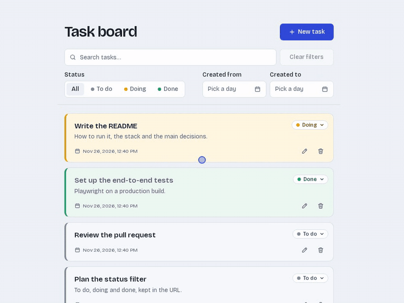
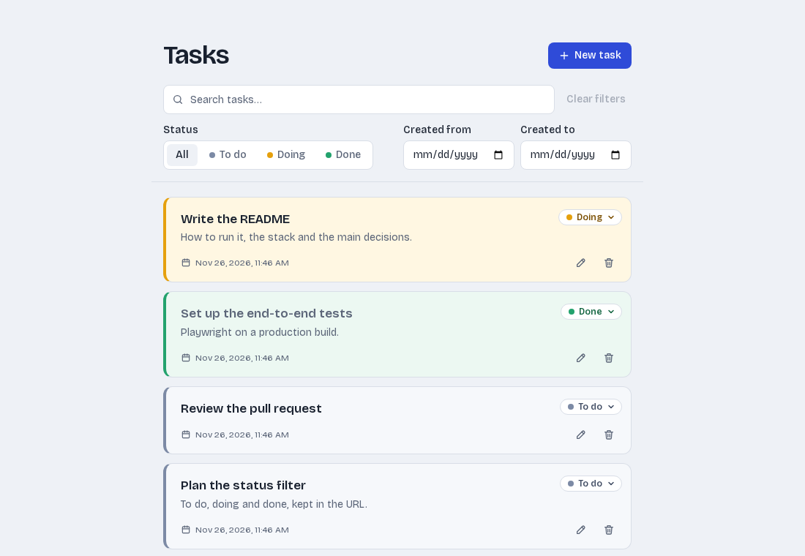
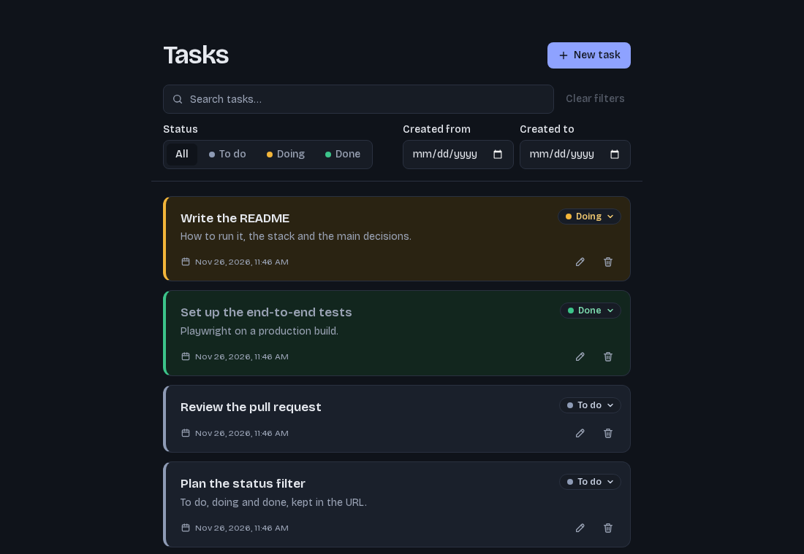

# Task manager

A task manager where you create, edit and delete tasks, move each one between **To do**, **Doing** and **Done** with one click, and find them by title, creation date or status, while the list loads more as you scroll. It is built with Next.js 16 (App Router, server-side rendering), tRPC and TanStack Query, on a back end that keeps the tasks in memory. It was built for a technical test; the statement is in [`docs/SPEC.md`](docs/SPEC.md).



| Light theme                                                     | Dark theme                                                    |
| --------------------------------------------------------------- | ------------------------------------------------------------- |
|  |  |

## Quick start

You need Node.js 24 and pnpm 12 ([requirements](#requirements)).

```bash
pnpm install
pnpm dev    # open http://localhost:3000
```

Or with Docker: `docker build -t task-manager . && docker run --rm -p 3000:3000 task-manager`.

The list starts empty, since the tasks live in memory: press **New task** to add one. Other ways to run the app, and the tests, are in [Run](#run) and [Test](#test).

## Highlights for reviewers

- **SSR with hydration, no second fetch.** The server prefetches the first page through the router, without HTTP, and hands it to the browser's TanStack Query cache, so the browser starts from it. Dates render in UTC on the server and switch to local time after hydration, with no mismatch ([D-27](docs/DECISIONS.md#d-27-list-page-rendering), [D-14](docs/DECISIONS.md#d-14-dates-rendered-in-utc-on-the-server-local-time-after-hydration)).
- **Pagination by position.** The cursor is the `createdAt` and `id` of a page's last task, so the infinite scroll stays correct when tasks are created or deleted between pages, and filters apply before a page is cut ([D-21](docs/DECISIONS.md#d-21-position-cursor), [D-31](docs/DECISIONS.md#d-31-infinite-scroll-on-the-list), [D-34](docs/DECISIONS.md#d-34-title-search-and-creation-date-filter-on-the-list)).
- **Errors by code, end to end.** The entity throws domain errors with literal codes, one middleware maps them to tRPC codes, and one UI module maps codes to text. An unexpected error reaches the browser with no detail and is logged on the server ([D-07](docs/DECISIONS.md#d-07-errors-as-domain-codes-translated-in-one-place), [D-25](docs/DECISIONS.md#d-25-error-responses-and-transport)).
- **One source of rules.** The same strict Zod schemas validate the procedures and the form; the limits are defined once and the entity guards them again ([D-06](docs/DECISIONS.md#d-06-one-zod-contract-shared-by-server-and-form-invariants-in-the-entity), [D-20](docs/DECISIONS.md#d-20-limits-title-120-description-1000-page-10-max-50)).
- **A small hexagonal back end.** The domain imports no framework, which ESLint enforces; one use case per operation; an in-memory repository behind a contract ([D-04](docs/DECISIONS.md#d-04-hexagonal-architecture-with-a-repository-on-the-back-end), [D-17](docs/DECISIONS.md#d-17-layer-rule-enforced-with-no-restricted-imports)).
- **Tested at three levels.** Unit and component tests with Vitest (100% of lines and branches on server code, gated at 90%) and end-to-end tests with Playwright, on the same standalone server the Docker image runs ([D-08](docs/DECISIONS.md#d-08-lean-test-strategy), [D-18](docs/DECISIONS.md#d-18-e2e-tests-on-a-production-build-chromium-only), [D-39](docs/DECISIONS.md#d-39-docker-image-from-the-standalone-output)).
- **Built with an AI-assisted workflow.** `CLAUDE.md` and `.claude/` hold the rules, skills, plan reviewer and git hook used to build the app with Claude Code; every change started from a plan in [`docs/plans/`](docs/plans/).

## How it works

**Pages.** `/` lists the tasks, newest first: the first page is rendered on the server and handed to the browser, and more pages load as the user scrolls. The list can be searched by title and filtered by creation date and status. `/tasks/new` and `/tasks/<id>/edit` share one form; from the list, they open in a modal over it. Each action shows its loading, success and failure states.

**Request path.** The pages talk to the back end only through tRPC, with TanStack Query caching the results in the browser:

```
list or form ─► tRPC client ─► /api/trpc ─► controller ─► use case ─► Task entity
                                  (strict Zod input)                 └► repository (in memory)
```

On the server, the list page calls the same router directly, without HTTP, and hands the result to the browser's cache ([D-27](docs/DECISIONS.md#d-27-list-page-rendering)).

The controller validates the input shape with the shared Zod schema, calls one use case (`CreateTask`, `ListTasks`, `GetTask`, `UpdateTask`, `ChangeTaskStatus`, `DeleteTask`) and returns an output object built field by field. The `Task` entity guards the rules (a title is required, length limits); the repository only stores and returns copies.

**Errors.** An expected failure is a domain error with a code (`TASK_NOT_FOUND`, `TASK_TITLE_REQUIRED`…). One middleware turns the code into a tRPC code (`NOT_FOUND`, `BAD_REQUEST`, `CONFLICT`), and one module in the UI turns codes into messages; anything unexpected becomes a generic message, with no internal detail sent to the browser.

**Back-end layers.** Hexagonal: `src/server/domains/task/` holds the entity, the repository contract with its in-memory implementation beside it, and the use cases, and imports no framework; `src/server/adapters/` holds what knows tRPC. The tasks live in a `Map` kept on `globalThis`, so they survive hot reload in development and are shared by the pages and the API route, which Next.js bundles separately ([D-05](docs/DECISIONS.md#d-05-in-memory-repository-kept-on-globalthis), [D-30](docs/DECISIONS.md#d-30-only-plain-data-is-shared-on-globalthis)). Restarting the server empties the list.

**Where the code lives.**

| Path          | What                                                                                                                                                                                                                          |
| ------------- | ----------------------------------------------------------------------------------------------------------------------------------------------------------------------------------------------------------------------------- |
| `src/app/`    | Next.js routes: the pages, the `/api/trpc` handler, and each page's own components in its `_components/<name>/` (the list, the task card, the filters, the date)                                                              |
| `src/server/` | the back end: `domains/task/` (entity, repository, use cases), `adapters/` (tRPC), composition                                                                                                                                |
| `src/shared/` | what both sides use: limits, Zod schemas, the list query options, the query client factory                                                                                                                                    |
| `src/client/` | `shared/<name>/`: what more than one component or page uses (the form, the edit loader, the modal, the status picker, the toast, the icons, the code-to-message module, the hydration hook); `trpc/`: the tRPC React provider |
| `src/test/`   | test helpers: factories, the tRPC test links, the fake `IntersectionObserver`, the DOM setup                                                                                                                                  |
| `e2e/`        | Playwright tests, with `createTask` (`api.ts`) and `gotoHydrated` (`hydration.ts`)                                                                                                                                            |

**Look.** Styled with Tailwind CSS as a colored board: each task card is tinted and edged with its status color, in the Bricolage Grotesque typeface, with dark mode following the system ([D-33](docs/DECISIONS.md#d-33-styling-with-tailwind-css-only), [D-37](docs/DECISIONS.md#d-37-a-colored-board-look)).

The main decisions, each with its reason, are in [`docs/DECISIONS.md`](docs/DECISIONS.md). The code has no explanatory comments: exported functions carry a JSDoc on what they do ([D-38](docs/DECISIONS.md#d-38-jsdoc-on-exported-functions-no-other-comments)).

## Task model

The spec names the fields in Portuguese; the code is in English ([D-03](docs/DECISIONS.md#d-03-english-everywhere-including-the-task-fields)):

| Spec          | Code          | Type                                                    |
| ------------- | ------------- | ------------------------------------------------------- |
| `id`          | `id`          | string, a UUID generated by the server                  |
| `titulo`      | `title`       | string, required, up to 120 characters after trimming   |
| `descricao`   | `description` | string or `null`, up to 1000 characters after trimming  |
| `dataCriacao` | `createdAt`   | date, set by the server                                 |
| —             | `status`      | `todo`, `doing` or `done`; `todo` when not given (D-36) |

## API

The back end is a tRPC router served at `/api/trpc` (one call per HTTP request: batching is off). Inputs are validated by strict Zod schemas that the create/edit form also uses ([`src/shared/tasks/task-schemas.ts`](src/shared/tasks/task-schemas.ts)): unknown fields are rejected, and text is trimmed.

| Procedure           | Kind     | Input                                                                                                                                                                                                                                                                                                                                                                                                          | Output                                                        |
| ------------------- | -------- | -------------------------------------------------------------------------------------------------------------------------------------------------------------------------------------------------------------------------------------------------------------------------------------------------------------------------------------------------------------------------------------------------------------- | ------------------------------------------------------------- |
| `task.list`         | query    | `{ cursor?: string \| null; limit?: number; direction?: 'forward' \| 'backward'; titleContains?: string; createdFrom?: string; createdBefore?: string; status?: Status }` (limit 1 to 50, default 10; `direction` is ignored, D-25; `titleContains` matches part of the title ignoring case; `createdFrom` inclusive and `createdBefore` exclusive, ISO 8601 UTC, D-34; `status` keeps only that status, D-36) | `{ items: Task[]; nextCursor: string \| null }`, newest first |
| `task.getById`      | query    | `{ id: string }`                                                                                                                                                                                                                                                                                                                                                                                               | `Task`                                                        |
| `task.create`       | mutation | `{ title: string; description?: string; status?: Status }`                                                                                                                                                                                                                                                                                                                                                     | `Task`                                                        |
| `task.update`       | mutation | `{ id: string; title: string; description?: string; status: Status }`                                                                                                                                                                                                                                                                                                                                          | `Task` (an omitted `description` clears it)                   |
| `task.changeStatus` | mutation | `{ id: string; status: Status }`                                                                                                                                                                                                                                                                                                                                                                               | `Task`                                                        |
| `task.delete`       | mutation | `{ id: string }`                                                                                                                                                                                                                                                                                                                                                                                               | `{ id: string }`                                              |

`Task` is `{ id, title, description: string | null, status, createdAt }`, with `createdAt` as an ISO 8601 string. `Status` is `'todo' | 'doing' | 'done'`.

Errors carry `data.code` (the tRPC code), `data.domainCode` (for example `TASK_NOT_FOUND` with `NOT_FOUND`, or `TASK_STORAGE_FULL` with `CONFLICT` once 1000 tasks are stored) and, for invalid input, `data.fieldErrors` (`BAD_REQUEST`). Unexpected errors reach the client as `INTERNAL_SERVER_ERROR` without detail and are logged on the server. Details in [`docs/DECISIONS.md`](docs/DECISIONS.md) (D-15, D-25, D-36).

## List page

`/` shows the tasks, newest first. The heading is static; the list is rendered on the server for every request: the page fetches the first page through tRPC on the server and hands it to the browser's query cache, so the browser shows it without requesting it again. Dates appear in UTC in the server HTML and switch to the browser's local time once the page is interactive. Deleting a task shows a short message (`Task deleted.` or the error) and refreshes the list; the delete buttons stay disabled until it has refreshed. If the list cannot be loaded, a `Retry` button tries again. Scrolling near the end loads the next page (`Loading more tasks…`; on failure, the error and a `Retry` button; `No more tasks.` after the last page); on a screen taller than the first page, the second one loads right away. Details in [`docs/DECISIONS.md`](docs/DECISIONS.md) (D-27, D-28, D-31).

Each task shows its status (`To do`, `Doing` or `Done`) as a colored pill. Choosing another value in the pill saves it at once and shows `Status updated.` (or the error). The heading, `New task` and the filters stay at the top while the page scrolls.

- **Search by title:** finds part of a title, ignoring case and accents ("acao" finds "Ação"). It applies a moment after you stop typing.
- **Created from / Created to:** days in your time zone, both included.
- **Status:** `All`, `To do`, `Doing` or `Done`.
- **Clear filters:** empties every filter at once.
- **The URL:** the filters live in it (`/?titleContains=…&createdFrom=…&createdBefore=…&status=…`), so a reload or a shared link renders the same filtered list on the server. While new results load, the previous ones stay on screen, dimmed; with no match, the list shows `No tasks match the filters.` (D-34).

## Create and edit

`New task` on the list opens `/tasks/new` and `Edit` opens `/tasks/<id>/edit` in a modal over the list. The list behind it keeps its filters. `Close`, Escape, a click outside or the browser's Back closes it. Loading either URL directly, or refreshing it, shows the full page instead. The edit form loads the task in the browser. Both use one form, with a title, a description and a status (`To do` for a new task): the title is required and the text fields have length limits, checked with the same schema the server uses before anything is sent. Each text field shows its count of characters, and a field past its limit shows its message as you type; on Save, an invalid field (such as an empty title) shows its message and gets the focus. While saving, the button shows `Saving…` and is disabled. A failed save shows a message in the form (for example, when the task was deleted meanwhile, or the list is full). A successful one closes the modal, or returns to the list from the full page, and the list shows `Task created.` or `Task saved.`. A task that does not exist shows `This task no longer exists.` on the edit page; if the task cannot be loaded for another reason (for example, the network), a `Retry` button tries again. Details in [`docs/DECISIONS.md`](docs/DECISIONS.md) (D-29, D-35).

## Requirements

- Node.js 24.22.2 (see `.nvmrc`)
- pnpm 12. The exact version is pinned in `package.json` (`packageManager`), and pnpm switches to it automatically.
- Internet access for `pnpm build` and `pnpm dev`: Next.js downloads the font (Bricolage Grotesque) and serves it from the app ([D-37](docs/DECISIONS.md#d-37-a-colored-board-look)).

## Run

```bash
pnpm install
pnpm dev                    # development server on http://localhost:3000
pnpm build && pnpm start    # production build and server
```

### With Docker

```bash
docker build -t task-manager .
docker run --rm -p 3000:3000 task-manager   # http://localhost:3000
```

A two-stage build: the first stage installs the dependencies and builds the app; the second holds only Node.js and Next.js's standalone output, and runs it as the non-root `node` user, so the image carries no source, no pnpm and no dev dependencies ([D-39](docs/DECISIONS.md#d-39-docker-image-from-the-standalone-output)).

Tasks live in memory, so restarting the server empties the list.

## Test

```bash
pnpm test                   # unit and component tests (Vitest)
pnpm test:coverage          # the same, with the 90% coverage gate on server code

pnpm exec playwright install chromium   # once, to download the browser
pnpm test:e2e               # end-to-end tests (Playwright) on a production build
```

`pnpm test:e2e` builds the app and starts its own server on port 3100, so every run starts from an empty task list. The e2e tests run one at a time: they share that in-memory server and look for their tasks on the first page.

## Lint and format

```bash
pnpm lint                   # route types, then ESLint, including the architecture import rules
pnpm typecheck              # route types, then the TypeScript compiler
pnpm format:check           # Prettier check (pnpm format to fix)
```

## Decisions and plans

- [`docs/DECISIONS.md`](docs/DECISIONS.md): the main decisions, each with its context and reasons: versions, architecture, contract, tests.
- [`docs/plans/`](docs/plans/): the roadmap and the implementation plan of each part.
